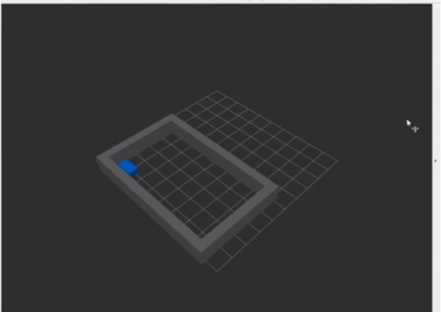

# 基于 ROS 与 Rviz 的 2D 激光雷达感知与自主避障仿真

## 任务说明
本项目在 ROS 节点底层模拟了激光雷达（LaserScan）传感器的数据发布，并实现了基于雷达测距的自主避障算法。机器人在包含多重障碍物的封闭环境内，通过实时感知前方距离，自动进行路径探索与转向避障。通过 Rviz 进行 3D 可视化展示。

## 运行环境
- Ubuntu 20.04
- ROS Noetic
- Python 3.8

## 依赖安装
运行本项目前，请确保已安装 ROS 核心及可视化工具：
sudo apt install ros-noetic-rviz -y

## 文件结构
```

src/
└── lidar_avoidance_sim/
├── package.xml
├── CMakeLists.txt
├── launch/
│   └── lidar_sim.launch
├── rviz/
│   └── lidar.rviz
├── scripts/
│   └── main.py
└── docs/
├── README.md
└── lidar_demo.gif

```

## 运行步骤
1. 编译工作空间：cd ~/catkin_ws && catkin_make
2. 加载环境变量：source devel/setup.bash
3. 一键启动仿真：roslaunch lidar_avoidance_sim lidar_sim.launch
4. 观察 Rviz 窗口，机器人会自动在封闭的房间内游走，红色的雷达线会实时扫描并避开前方的灰色墙壁。

## 运行结果


## 大模型声明
代码由本人参考 ROS 官方文档和课程资料编写，使用大模型辅助生成。
```
