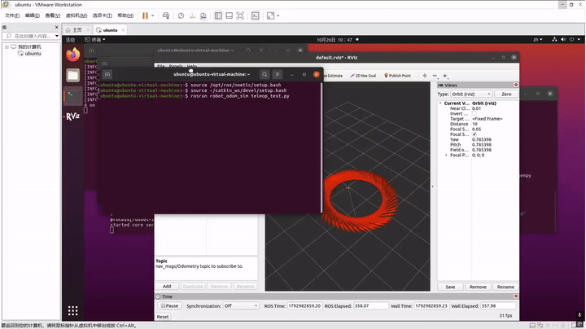

# 差速机器人运动学积分与轮式里程计仿真

## 项目简介
本实验基于 ROS 1 (Noetic) 搭建了一个两轮差速机器人的底层运动学仿真节点。通过接收外部节点的 `/cmd_vel` (`geometry_msgs/Twist`) 速度指令，将线速度与角速度进行前向欧拉积分，实时解算出机器人的全局位姿（\(x, y, \theta\)）。同时，节点会发布标准的 `nav_msgs/Odometry` 轮式里程计消息，并广播 `odom` 到 `base_link` 的 `/tf` 坐标变换树。此外，系统内置了速度超时保护机制，确保仿真过程的安全稳定。

## 运行环境
*   **操作系统**：Ubuntu 20.04 (VMware 虚拟机)
*   **ROS 版本**：ROS 1 Noetic
*   **Python 版本**：3.8
*   **可视化工具**：Rviz

## 核心算法与公式
机器人的位姿更新基于二维平面运动学积分模型。设当前时刻为 \(t\)，采样时间间隔为 \(\Delta t\)，线速度为 \(v\)，角速度为 \(\omega\)。
则机器人的位姿更新公式为：

\[
 x_{t} = x_{t-1} + v \cdot \cos(\theta_{t-1}) \cdot \Delta t 
\]
\[
 y_{t} = y_{t-1} + v \cdot \sin(\theta_{t-1}) \cdot \Delta t 
\]
\[
 \theta_{t} = \theta_{t-1} + \omega \cdot \Delta t 
\]

解算后的欧拉角 \(\theta\) 需转换为四元数（Quaternion），用于在 ROS 中发布 TF 坐标变换。

## 文件结构说明
| 文件/目录 | 功能描述 |
| :--- | :--- |
| `scripts/main.py` | 核心节点，负责运动学积分、TF广播与Odom消息发布 |
| `scripts/teleop_test.py` | 键盘监听节点，捕获按键并下发速度控制指令 |
| `launch/robot_odom.launch` | 一键启动脚本，包含仿真节点、键盘控制与Rviz |
| `rviz/robot_odom.rviz` | Rviz预设配置文件，自动加载TF与轨迹显示 |
| `CMakeLists.txt` | 编译与安装规则配置 |

## 安装依赖
在运行本实验前，请确保已安装以下 ROS 功能包：
```bash
sudo apt install ros-noetic-tf ros-noetic-nav-msgs ros-noetic-rviz -y
```

运行步骤

1. 编译工作空间并加载环境变量：
   ```bash
   catkin_make
   source devel/setup.bash
   ```
2. 一键启动仿真环境与可视化界面：
   ```bash
   roslaunch robot_odom_sim robot_odom.launch
   ```
3. 在弹出的终端中，使用键盘的 W/A/S/D 键控制机器人，并在 Rviz 中观察坐标轴与轨迹的变化。

运行效果


大模型使用声明

代码与文档编写过程中使用了大模型进行辅助生成，核心逻辑与测试已由本人独立完成并验证。

```

